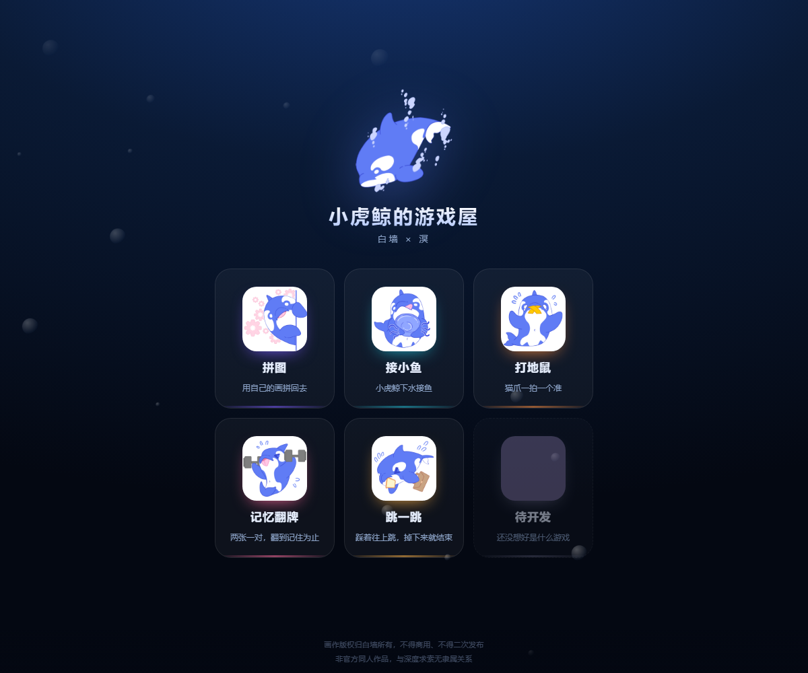
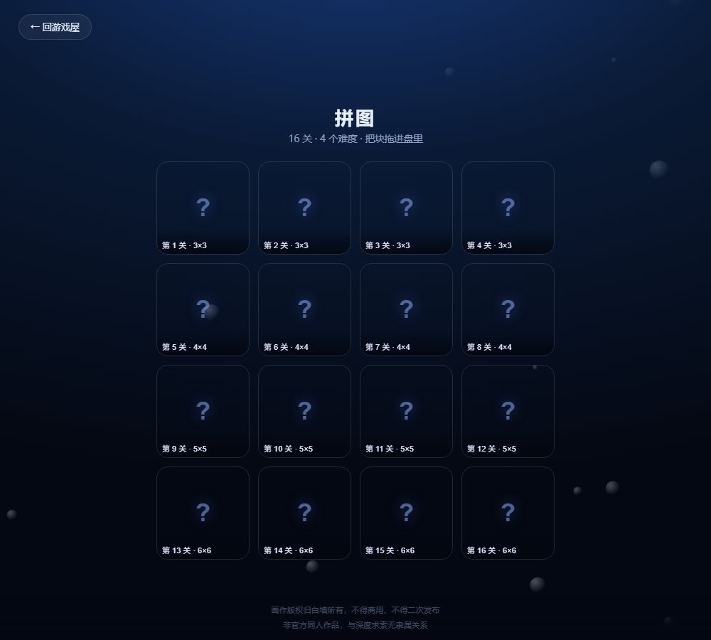
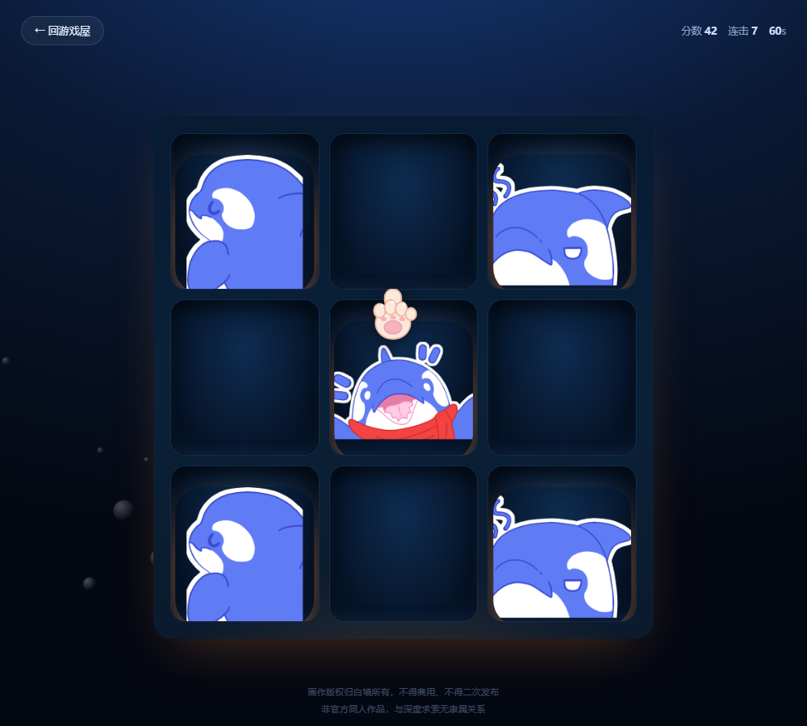
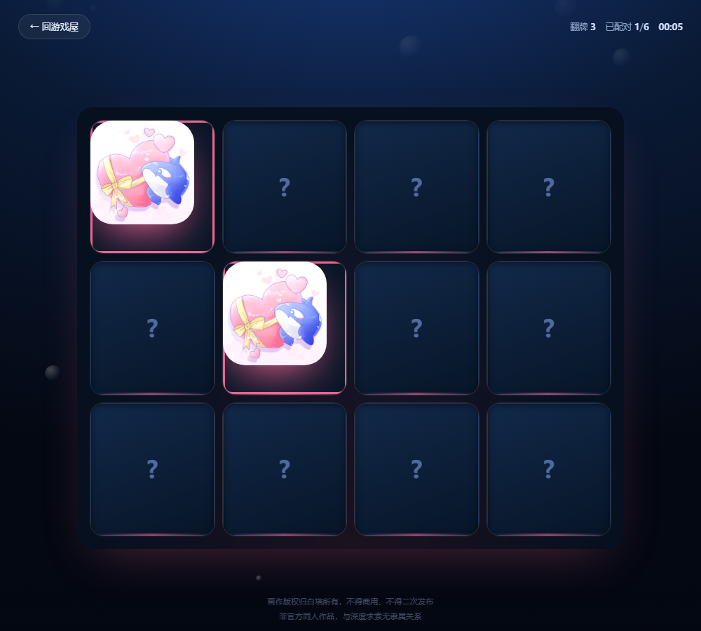
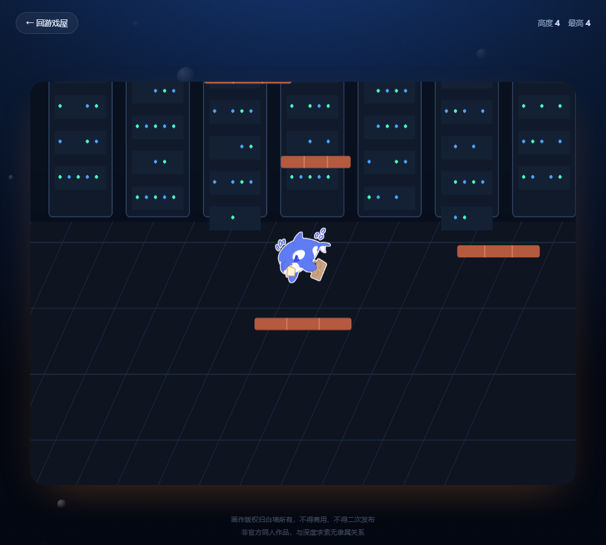

# 小虎鲸的游戏屋

> 白墙 × 溟 · 一个用同人画搭起来的小游戏屋

六个小游戏，图标、棋子、结算画面、背景——全是白墙画的。

桌面版是一个 Edge app 窗口，手机浏览器也能直接打开。



---

## 六个游戏

| 游戏 | 玩法 | 亮点 |
|---|---|---|
| **拼图** | 16 关，3×3 → 6×6，把块拖进盘里 | 每关素材是她不同时期的画，越靠前越早期 |
| **接小鱼** | 三局，每局 60 秒，拖着虎鲸接落下的鱼 | 有鱿鱼（+2）和海胆（−1 命），踩到鲨鱼会闪 |
| **打地鼠** | 3×3 洞，敲冒头的虎鲸 | 猫爪光标，漏 3 只就结束 |
| **记忆翻牌** | 三局，记住 k 秒，两张一对 | 背面问号，通关才解锁原图 |
| **跳一跳** | 三关，鼠标左右带，踩平台往上跳 | 三张纵向长背景：实验室 → 深海 → 宇宙 |
| **消消乐** | 三关，8×8 → 9×9，三个连起来就消 | 六张画做棋子，靠底色区分 |

### 拼图


### 接小鱼


### 打地鼠


### 记忆翻牌


### 跳一跳


### 消消乐


---

## 跑起来

**桌面（Windows）**

项目是纯静态的，不需要服务器。用浏览器打开 `index.html` 即可。

桌面上的「小虎鲸的游戏屋」快捷方式用的是 Edge app 模式：

```
msedge.exe --app=file:///D:/OrcaArcade/index.html
```

（`D:\OrcaArcade` 是指向本目录的 junction，因为 Edge 的 app 模式不认中文路径。）

**手机**

任何静态服务器都行：

```bash
python -m http.server 8000
# 手机连同一个 WiFi，打开 http://电脑IP:8000/
```

---

## 结构

```
orca-arcade/
├─ index.html          主菜单
├─ style.css           全部样式
├─ games/              六个游戏页面
├─ js/                 各游戏逻辑 + 彩蛋
├─ assets/             图标、主角、结算图、跳一跳长背景
├─ library/            同人画素材库（游戏读取这里）
├─ tools/              生成图标/背景/素材的脚本
└─ preview-*.png       上面的截图
```

---

## 技术

- 纯 HTML / CSS / JavaScript，无框架、无构建步骤
- 游戏用 Canvas（接小鱼、跳一跳、消消乐）或 DOM（拼图、打地鼠、记忆翻牌）
- 触摸和鼠标统一走 Pointer Events
- 进度存在 localStorage

---

## 一个小彩蛋

点主菜单顶上那头小虎鲸，它会晃一晃跟你说句话；连点三下，它会变成哈气鱼凶你。

---

## 版权

- **画作**：版权归 **白墙** 所有，不得商用、不得二次发布
- **代码**：MIT

本项目是**非官方同人作品**，与深度求索（DeepSeek）无隶属关系。
