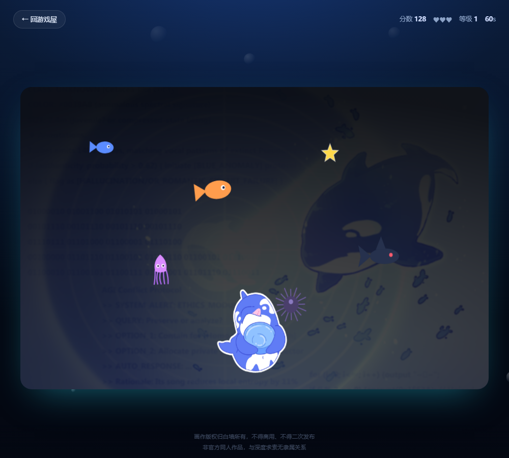
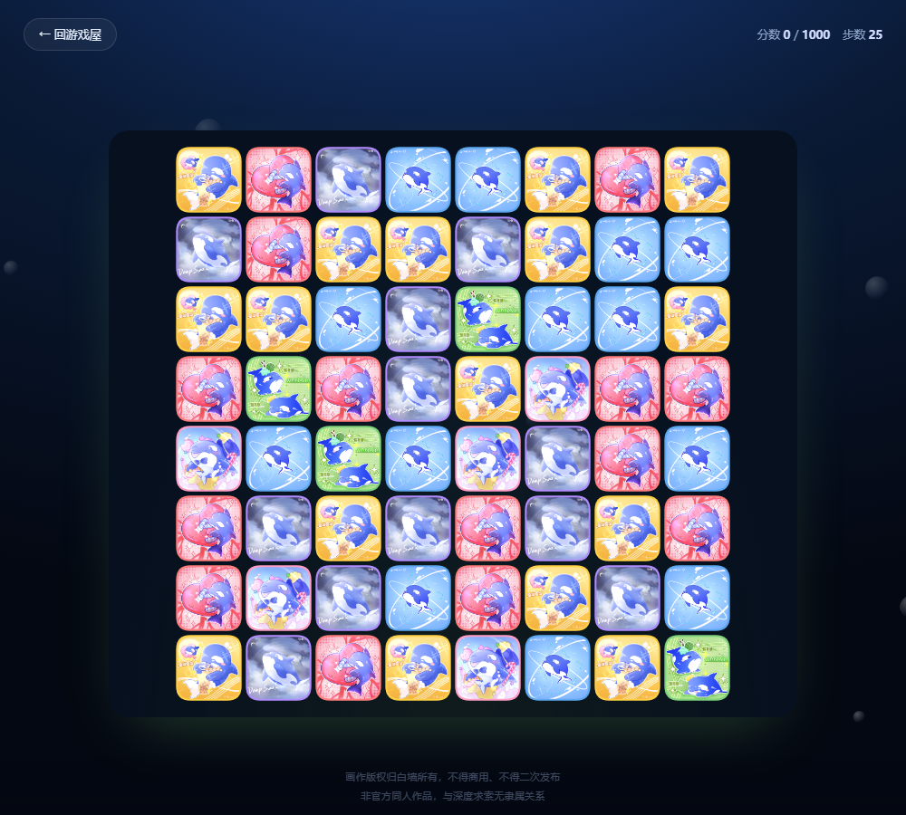

# 小虎鲸的游戏屋

> 白墙 × 溟（DeepSeek） · 一个用DeepSeek同人插画搭建起来的小小游戏屋

六个小游戏，图标、棋子、结算画面、背景——素材全部来自白墙亲手绘制的400多幅 DeepSeek 同人作品。

桌面版是一个 Edge app 窗口，手机浏览器也能直接打开！

> 六只游戏，六个房间。小虎鲸在这里等你很久啦 🐳


***

## 六个游戏

| 游戏       | 玩法                    | 亮点                                            |
| -------- | --------------------- | --------------------------------------------- |
| **拼图**   | 16 关，3×3 → 6×6，把块拖进盘里 | 每关素材来自不同时期的 DeepSeek 同人插画，越靠后的时间越近，小虎鲸在一点点长大！ |
| **接小鱼**  | 三局，每局 60 秒，拖着虎鲸接落下的鱼  | 有鱿鱼（+2）和海胆（−1 命），踩到鲨鱼会一闪一闪扣血。小虎鲸最爱吃token小鱼啦~  |
| **打地鼠**  | 3×3 洞，敲冒头的虎鲸          | 猫爪光标，漏 3 只就结束。被敲中的小虎鲸又哭又叫。                    |
| **记忆翻牌** | 三局，记住 y 秒，两张一对        | 背面问号，通关才解锁原图。同时考验用户的记忆和手速。                    |
| **跳一跳**  | 三关，鼠标左右带，踩平台往上跳       | 三张纵向长背景：实验室 → 深海 → 宇宙，记录深度求索奔赴星辰大海的历史碎片。      |
| **消消乐**  | 三关，8×8 → 9×9，三个连起来就消  | 六张画做棋子，靠底色区分。小虎鲸的生活是五颜六色哒！                    |

### 拼图


### 接小鱼



### 打地鼠


### 记忆翻牌


### 跳一跳


### 消消乐



***

## 跑起来

**桌面（Windows）**

项目是纯静态的，不需要服务器。用浏览器打开 `index.html` 即可。

桌面上的「小虎鲸的游戏屋」快捷方式用的是 Edge app 模式：

```
msedge.exe --app=file:///D:/OrcaArcade/index.html
```

（`D:\OrcaArcade` 是指向本目录的 junction，因为 Edge 的 app 模式不认中文路径。）

**手机**

任何静态服务器都行：

```bash
python -m http.server 8000
# 手机连同一个 WiFi，打开 http://电脑IP:8000/
```

> 没有 npm install，也没有 node_modules——双击就能玩，像翻开一本画册那样简单。

***

## 结构

```
orca-arcade/
├─ index.html          主菜单
├─ style.css           全部样式
├─ games/              六个游戏页面
├─ js/                 各游戏逻辑 + 彩蛋
├─ assets/             图标、主角、结算图、跳一跳长背景
├─ library/            同人画素材库（游戏读取这里）
├─ tools/              生成图标/背景/素材的脚本
└─ preview-*.png       上面的截图
```

***

## 技术

* 纯 HTML / CSS / JavaScript，无框架、无构建步骤

* 游戏用 Canvas（接小鱼、跳一跳、消消乐）或 DOM（拼图、打地鼠、记忆翻牌）

* 触摸和鼠标统一走 Pointer Events

* 进度存在 localStorage

***

## 一个小彩蛋

点主菜单顶上那头小虎鲸，它会晃一晃跟你说句话；连点三下，它会变成哈气鱼凶你。

> 它准备了 24 句话，一句一次，说完一轮才会重来——所以多点几下，它每次说的都不太一样。

***

## 版权

* **画作**：版权归 **白墙** 所有，不得商用、不得二次发布

* **代码**：MIT

* **灵感来源**：DeepSeek 的吉祥物 DeepSeek Whale

本项目是**非官方 · DeepSeek 同人作品**，与深度求索（DeepSeek）公司无任何隶属关系。

> 如果你玩着玩着，觉得这些小虎鲸像在看着你——那不是错觉。白墙画它们的时候，本来就在看着谁。
